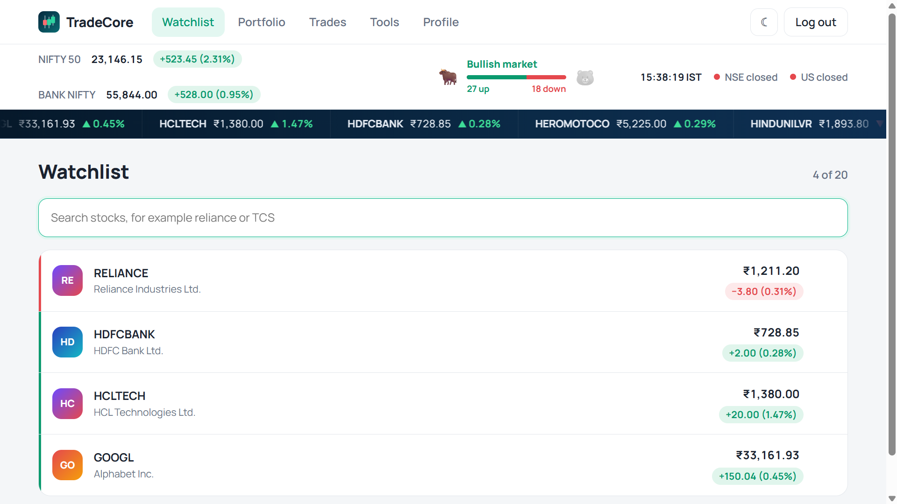
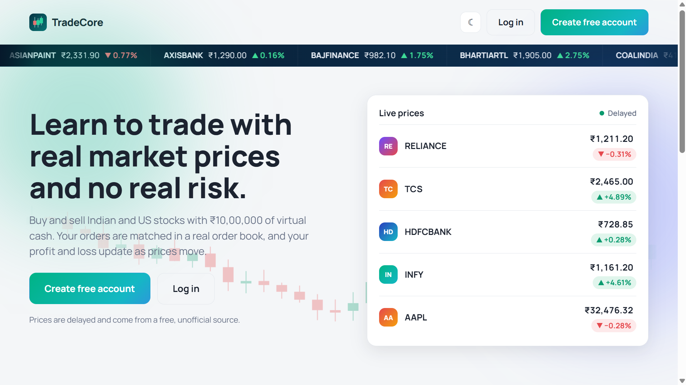

# TradeCore

A paper-trading platform: practise buying and selling Indian and US stocks with **virtual money and real (delayed) market prices**. It has a custom C++ matching engine, a Node.js and TypeScript backend, and a React frontend.

> No order is ever sent to a real exchange. All money is virtual.

## What it does

Users register, confirm their email, and get a virtual ₹10,00,000 balance. They can:

- Search 45 stocks (31 Indian NSE stocks and 14 US stocks) and keep a watchlist.
- Place **market** and **limit** orders, cancel open orders, and queue **after-market (AMO)** orders that run when the exchange opens.
- Square off positions with one click.
- Follow profit and loss: average cost, realized and unrealized P&L, closed-trade reports, winning and losing trade counts.
- Watch prices update live on a scrolling ticker, price charts with real 1-minute candles, NIFTY and BANK NIFTY, and a bull or bear market-mood indicator.
- Use market movers, news headlines and short lessons.
- Switch between light and dark mode.

US stocks are converted to rupees at the live USD/INR rate, so everyone keeps one rupee wallet.

| | |
|---|---|
|  |  |
|  |  |

## Architecture

~~~mermaid
graph TD
    subgraph Browser
        FE[React frontend Vite + TypeScript]
    end

    subgraph "Node.js backend"
        API[Fastify REST API]
        WS[WebSocket server]
        SETTLE[Settlement service]
        MD[Market data price refresh + USD/INR]
        MM[Market maker]
        AMO[AMO scheduler]
    end

    subgraph "C++ matching engine"
        ENGINE[engine_server order book + matching]
    end

    PG[(PostgreSQL)]
    REDIS[(Redis pub/sub)]
    YAHOO[(Yahoo Finance unofficial, delayed)]
    BREVO[(Brevo email)]

    FE -- "REST" --> API
    FE -- "WebSocket" --> WS
    API -- "JSON over stdin/stdout" --> ENGINE
    API -- "reads and writes" --> PG
    API --> SETTLE
    SETTLE -- "trades, orders, balances, positions" --> PG
    SETTLE -- "publish order and trade events" --> REDIS
    MD -- "publish price ticks" --> REDIS
    WS -- "subscribe" --> REDIS
    MD --> YAHOO
    MM -- "quotes through the normal order path" --> API
    AMO -- "runs queued orders at open" --> API
    API --> BREVO
~~~

**Why a separate C++ engine?** Order matching is deterministic and performance-sensitive, so it is isolated and tested on its own (37 unit tests, GoogleTest).

**Why Postgres is the source of truth.** The order book lives in the engine's memory. Every order is saved to Postgres before it reaches the engine. If the backend restarts, open limit orders are replayed into a fresh engine and rebuild the same book without creating trades. If settlement ever fails after the engine has matched, the backend halts the engine instead of letting it run ahead of the database.

**Why Redis.** Price ticks and per-user order and trade events go through Redis pub/sub, so the real-time layer is not tied to one process.

## Key engineering decisions

- **Price-time priority matching.** Bids sorted high to low, asks low to high, each price level a FIFO queue.
- **Trades execute at the resting order's price,** as on a real exchange.
- **Integer cents for all money math** in the backend, so floating point never loses a paisa.
- **Funds and shares are reserved before an order reaches the engine.** A market buy gets a price cap from available cash, and a sell is checked against shares held minus shares already committed to open sells.
- **One serialized order queue.** Funds check, save, match, settle and cancel run one at a time, so two orders can never pass the same funds check.
- **One Postgres transaction per settlement.** The trade, both orders, both cash balances and both positions commit together or not at all.
- **Database safety nets.** CHECK constraints keep balances and share counts non-negative.
- **Market maker for liquidity.** A built-in account quotes bids and asks around the live price (three levels each side), so market orders fill even with a handful of users. It uses the same order path as everyone else, so there is no special case in settlement, and total cash across all accounts never changes.
- **Safety for strangers.** Email verification before trading, password reset by single-use hashed links, per-IP rate limits, and bcrypt with a password length cap.

## Tech stack

| Layer | Technology |
|---|---|
| Matching engine | C++20, CMake, GoogleTest |
| Backend | Node.js, TypeScript, Fastify, Drizzle ORM |
| Database | PostgreSQL 17 |
| Real-time | WebSocket (ws), Redis 8 pub/sub |
| Market data | Yahoo Finance (unofficial chart endpoint), USD/INR from the same source |
| Email | Brevo HTTP API (prints to the terminal when no key is set) |
| Frontend | React 19, TypeScript, Vite, React Router, TradingView Lightweight Charts |
| Infra | Docker Compose (nginx serves the built frontend) |

## Quick start (one command)

Needs only Docker.

    git clone <this repo>
    cd <this repo>
    docker compose -f docker-compose.demo.yml up --build

Then open http://localhost:8080 and create an account. The first build takes a few minutes because it compiles the C++ engine. The backend creates the database tables, the 45-stock catalog and the market-maker account on start.

Demo mode skips email verification and treats markets as always open, so you can trade at any hour. Outside real market hours, prices are the last known real price. Stop with `docker compose -f docker-compose.demo.yml down` (add `-v` to wipe the data).

## Local development

Needs Node.js 22, a C++20 compiler, CMake and Docker.

    # 1. Postgres and Redis
    docker compose up -d

    # 2. Build the engine
    cmake -S engine -B engine/build -DCMAKE_BUILD_TYPE=Release
    cmake --build engine/build --target engine_server

    # 3. Backend (copy backend/.env.example to backend/.env and set JWT_SECRET first)
    cd backend
    npm install
    npx drizzle-kit migrate
    npx tsx scripts/seed-instruments.ts
    npx tsx scripts/seed-market-maker.ts
    npx tsc && node dist/index.js

    # 4. Frontend (new terminal)
    cd frontend
    npm install
    npm run dev

## Tests and performance

Backend integration tests run the real app against a separate Postgres database and check settlement, funds and share reservation, price-time priority, cancellation, email verification and that total cash across all accounts never changes:

    cd backend && npm test

Measured on an Intel Core i5-13420H laptop (WSL2, Docker Postgres):

| What | Result |
|---|---|
| C++ engine through its JSON stdin/stdout protocol | about 38,000 orders/sec (200,000 random limit orders, 78% of them trading); single-order round trip p50 87 µs, p99 278 µs |
| Full order path: funds check, Postgres, engine, settlement transaction | about 70 orders/sec, about 36 settled trades/sec |

The full path is much slower on purpose: orders run one at a time so two orders can never pass the same funds check, and each makes several database round trips.

## Limitations

- **Prices are unofficial and delayed.** They come from Yahoo Finance's free chart endpoint, which has no SLA, is usually a few minutes late, and can rate-limit or change. This is not a licensed real-time feed.
- **Liquidity is simulated.** Orders match against other users and a market-maker account, not against a real exchange's order book.
- **US prices are converted to rupees,** so a US stock's rupee price keeps moving with the exchange rate, and P&L on US stocks includes the currency effect.
- **Market hours cover weekends and daily hours only,** not exchange holidays.
- **No futures or options.**
- **Not production hardened.** There is no licensed data, no monitoring, and a free-tier host may sleep.

## Project structure

    engine/     C++ matching engine (CMake, GoogleTest)
    backend/    Fastify API, Drizzle and Postgres, Redis, WebSocket, market maker, tests, benchmarks
    frontend/   React and Vite client
    docs/       Demo script and screenshots

See [docs/demo-script.md](docs/demo-script.md) for a guided walkthrough.
